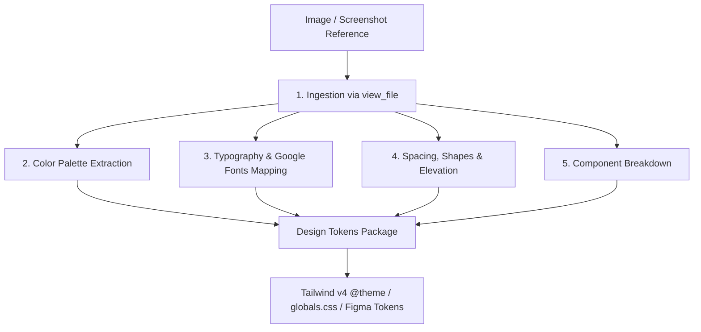

# Visual Reference Reverse-Engineering Playbook

This skill guides the **UI/UX Designer** and **Frontend Engineer** in systematically analyzing visual design references (mockups, screenshots, images, UI kits) using computer vision (`view_file`), deconstructing them into quantifiable design tokens, and exporting them as copy-pasteable CSS/Tailwind configurations.

---

## 1. When to Use This Skill

- User provides an image file (`.png`, `.jpg`, `.jpeg`, `.webp`, `.svg`) as a design reference.
- User requests: *"Make it look like this screenshot"*, *"Match the color scheme and fonts from this mockup"*, or *"Reproduce this dashboard/landing page layout"*.
- Reverse-engineering Figma exports, Dribbble shots, or competitor UI screenshots into design tokens.
- Auditing visual contrast (WCAG 2.1 AA/AAA) and generating dark mode equivalents.

---

## 2. Step-by-Step Analysis Protocol



### Step 1: Ingestion & Surface Identification
1. Use `view_file` on the target image path.
2. Identify the visual archetype:
   - **Modern SaaS / Tech Minimal**: Clean sans-serif, high contrast, subtle borders, slate/neutral grays, sharp accent (e.g., Linear, Vercel).
   - **Corporate & Enterprise**: Structured tables, compact density, muted blues/grays, formal hierarchy (e.g., Stripe Dashboard, Salesforce).
   - **Creative / Editorial**: Distinctive serif headings, asymmetric bento grids, warm off-whites, textured backgrounds.
   - **Dark Futuristic / Glassmorphism**: High-depth dark surfaces, glow gradients, `backdrop-filter: blur()`, neon accents.

---

### Step 2: Color Palette Extraction & Tokenization
Extract 5–7 core semantic colors and convert them to exact HEX and HSL codes:

1. **Dominant Background & Surface**:
   - `background`: Canvas color (e.g. `#FFFFFF` light / `#090D16` dark).
   - `surface`: Card and container background (e.g. `#F8FAFC` light / `#121826` dark).
   - `surface-elevated`: Popover, modal, dropdown surface (e.g. `#FFFFFF` light / `#1E2638` dark).
2. **Brand & Accent Colors**:
   - `primary`: Main CTA and active state color (e.g. `#4F46E5` Indigo).
   - `secondary`: Secondary actions and active highlights (e.g. `#06B6D4` Cyan).
   - `accent`: Attention grabbers, badges, notification pings.
3. **Typography & Content Colors**:
   - `text-primary`: Heading and high-emphasis body text (must achieve >= 4.5:1 contrast on background).
   - `text-secondary` / `text-muted`: Subtitles, captions, disabled states.
4. **Borders & Dividers**:
   - `border`: Subtle container boundary (e.g. `#E2E8F0` light / `#1E293B` dark).
   - `border-focus`: Accent boundary for active inputs.

---

### Step 3: Typography Identification & Google Fonts Pairing
Identify the visual font category from the image and map to identical or near-identical open-source Google Fonts:

| Reference Font Style | Characteristics | Recommended Google Fonts Pairing |
| :--- | :--- | :--- |
| **Geometric Sans** | Round circular bowls, modern tech feel (e.g. Circular, Futura) | **`Plus Jakarta Sans`** or **`Outfit`** (Headings) + **`Inter`** (Body) |
| **Neo-Grotesque** | Neutral, clean, maximum legibility (e.g. Helvetica, SF Pro, Inter) | **`Inter`** or **`Geist`** (Headings + Body) |
| **Humanist Sans** | Warm, open counters, friendly SaaS (e.g. Frutiger, Open Sans) | **`DM Sans`** or **`Work Sans`** (Headings) + **`DM Sans`** (Body) |
| **Editorial Luxury Serif**| High contrast, sharp serifs, elegant (e.g. Canela, Ogg) | **`Playfair Display`** or **`Cinzel`** (Headings) + **`Plus Jakarta Sans`** (Body) |
| **Warm Literary Serif** | Grounded, readable, bookish (e.g. Tiempos, Georgia) | **`Newsreader`** or **`Lora`** (Headings) + **`Inter`** (Body) |
| **Technical Monospace** | Grid-aligned, code aesthetics, data tables | **`JetBrains Mono`** or **`Geist Mono`** (Data / Code) |

**Font Weight & Scale Rules**:
- Headings: Display (`800`/`700`), Section Headers (`600`), Subtitles (`500`).
- Body: Standard (`400`), Emphasis (`500`).
- Always specify `font-display: swap` for optimal LCP Core Web Vitals.

---

### Step 4: Spacing, Shapes, and Elevation
Deconstruct spatial relationships:
1. **Grid & Spacing Scale**: Measure base padding units (usually 4px, 8px, 12px, 16px, 24px, 32px, 48px, 64px).
2. **Corner Radiuses**:
   - Sharp (`rounded-sm`: 2px–4px) for data tables and enterprise tools.
   - Smooth (`rounded-lg`: 8px–12px) for cards, inputs, and standard buttons.
   - Pill / Soft (`rounded-2xl` / `rounded-full`: 16px–9999px) for modern badges, floating chips, and hero CTAs.
3. **Shadow & Depth (Elevation)**:
   - *Flat / Minimal*: No shadow, 1px solid border (`border border-slate-200 dark:border-slate-800`).
   - *Soft Diffused*: Multi-layered soft drop shadow: `box-shadow: 0 10px 25px -5px rgba(0, 0, 0, 0.05), 0 8px 10px -6px rgba(0, 0, 0, 0.01)`.
   - *Glassmorphism*: Translucent fill with blur: `background: rgba(255, 255, 255, 0.7); backdrop-filter: blur(12px); border: 1px solid rgba(255, 255, 255, 0.2)`.

---

## 3. Deliverable: Ready-to-Use Tailwind CSS v4 `@theme`

When analysis is complete, generate the complete theme block for `src/app/globals.css`:

```css
@import "tailwindcss";

@theme {
  /* Colors extracted from reference */
  --color-brand-primary: #4f46e5;
  --color-brand-secondary: #06b6d4;
  --color-brand-accent: #f59e0b;
  
  --color-surface-canvas: #ffffff;
  --color-surface-card: #f8fafc;
  --color-surface-elevated: #ffffff;
  
  --color-text-main: #0f172a;
  --color-text-muted: #64748b;
  --color-border-subtle: #e2e8f0;

  /* Typography */
  --font-heading: "Plus Jakarta Sans", sans-serif;
  --font-body: "Inter", sans-serif;

  /* Elevation */
  --shadow-soft: 0 10px 30px -5px rgba(15, 23, 42, 0.06);
  --shadow-elevated: 0 20px 40px -10px rgba(15, 23, 42, 0.1);

  /* Radius */
  --radius-card: 16px;
  --radius-button: 10px;
}

/* Dark Mode Tokens */
@custom-variant dark (&:is(.dark *));

.dark {
  --color-surface-canvas: #090d16;
  --color-surface-card: #121826;
  --color-surface-elevated: #1e2638;
  --color-text-main: #f8fafc;
  --color-text-muted: #94a3b8;
  --color-border-subtle: #1e293b;
}
```
