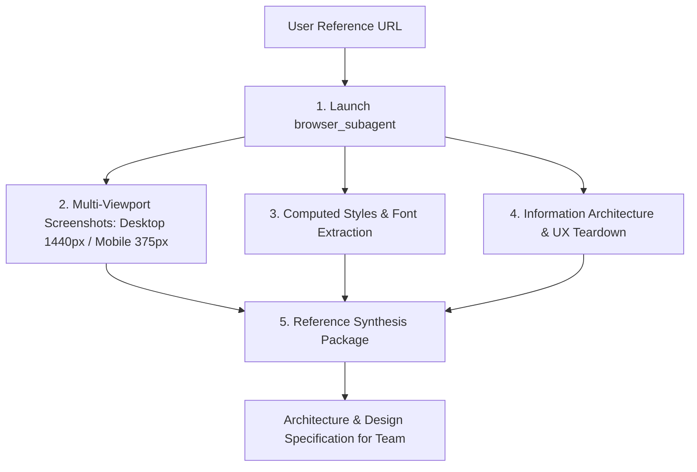

# Live Website Reference Reverse-Engineering Playbook

This skill guides the **UI/UX Designer**, **Web Architect**, and **Frontend Engineer** in systematically analyzing live competitor or reference websites using `browser_subagent` and `read_url_content`, extracting architectural and design patterns, and synthesizing them into actionable implementation specifications.

---

## 1. When to Use This Skill

- User provides one or more URLs: *"Build a landing page with the look and feel of linear.app"*, *"Use Stripe's pricing table UX"*, or *"Analyze this competitor portal and create a similar layout"*.
- Benchmarking information architecture, navigation patterns, and hero section dynamics from benchmark sites.
- Extracting computed typography, color palettes, responsive breakpoint behaviors, and micro-interactions from public web applications.

---

## 2. Step-by-Step Analysis Protocol



### Step 1: Automated Visual Exploration via `browser_subagent`
Instruct `browser_subagent` to perform multi-viewport inspection:
1. **Navigate to URL**: Visit the site, bypass cookie banners if necessary.
2. **Desktop Viewport (1440x900)**:
   - Capture full-page screenshot or above-the-fold viewport.
   - Note header positioning (sticky, blur background, navigation dropdowns).
   - Note hero composition (H1 copy, primary/secondary CTA alignment, visual anchor e.g. 3D canvas, video, or product preview).
3. **Mobile Viewport (375x812)**:
   - Resize browser to 375px.
   - Inspect mobile navigation (hamburger menu, bottom navigation bar, sheet drawer).
   - Verify responsive stacking of multi-column bento grids.
4. **Scroll & Interaction Test**:
   - Scroll page to identify scroll-driven reveals, parallax effects, or sticky tab navigation.
   - Hover over primary buttons, cards, and links to observe hover micro-interactions.

---

### Step 2: Computed Style & Design System Extraction
Extract quantitative design metrics directly from the DOM:

1. **Typography**:
   - Inspect computed `font-family` on `<h1>` and `<body>`.
   - Inspect font weights (`font-weight: 600/700/800` vs `400`), `line-height`, and `letter-spacing` (tracking).
2. **Colors**:
   - Background colors (`getComputedStyle(body).backgroundColor`).
   - Button CTAs (background, text color, hover background).
   - Card backgrounds, border colors, and border opacities (`rgba()`).
3. **Shadows & Elevation**:
   - Measure `box-shadow` values on cards, popups, and dropdown menus.
   - Check for `backdrop-filter: blur(...)` on navigation bars.

---

### Step 3: Information Architecture & UX Teardown
Deconstruct the structural page skeleton into standard modular sections:

```text
Section Blueprint:
1. Navigation Bar: [Brand Logo | Nav Links with Dropdowns | Action CTAs (Sign In, Get Started)]
2. Hero Section: [Category Pill/Badge | Dynamic Headline | Value Prop Paragraph | Dual CTA | Product Visual/Mockup]
3. Social Proof / Logos: [Customer logos marquee, Trust badges, Rating counters]
4. Feature Grid (Bento Box): [Asymmetric grid showcasing core value propositions with interactive tabs]
5. Deep-Dive Showcase: [Alternating feature rows with interactive previews]
6. Interactive Comparison / ROI Calculator (if applicable)
7. Pricing Matrix: [Monthly/Annual toggle, Tier cards, Feature comparison checklist, Highlighted popular tier]
8. Testimonial Wall: [Masonry grid of user reviews with avatars and company badges]
9. FAQ Accordion: [Schema.org FAQPage-compatible expandable questions]
10. Final Conversion CTA: [High-impact visual banner with immediate signup form or button]
11. Footer: [Multi-column sitemap, social links, legal disclaimers, copyright]
```

---

### Step 4: Technical Stack & Architecture Assessment
Using `read_url_content` and network inspection:
- Identify rendering paradigm: Server-Side Rendered (Next.js/Remix), Static Site (Astro/Hugo), or Client SPA.
- Identify icon system: Lucide, Heroicons, Phosphor, FontAwesome, or custom SVGs.
- Identify animation approach: CSS transitions, Framer Motion (`framer-motion`), GSAP, or Lottie.

---

### Step 5: Deliverable — Reference Adaptation Plan

The UI/UX Designer synthesizes the findings into a formal document for the Architect and Developers:
1. **Executive Summary**: Core aesthetic tone, key differentiators, target user mood.
2. **Design Tokens**: Copy-pasteable Tailwind v4 `@theme` or CSS variables.
3. **Component Specs**: Layout structure for each section.
4. **Strict IP & Compliance Guardrail**:
   > [!IMPORTANT]
   > Adopt layout composition, design systems, and UX flows. **NEVER** copy copyrighted copy, trademarked logos, private assets, or proprietary code verbatim. Always replace with custom brand identity and unique copy.
