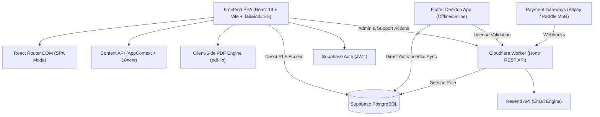
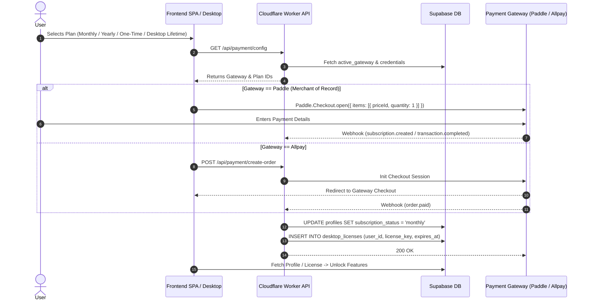

# 🏗 System Architecture & Tech Stack (`architecture.md`)

[⬅ Back to Master Index](file:///C:/Users/evgen/.gemini/antigravity-ide/brain/04176191-ab30-4c85-8015-3e381afe907d/master_index.md) | [Next: KDP Math Engine ➡](file:///C:/Users/evgen/.gemini/antigravity-ide/brain/04176191-ab30-4c85-8015-3e381afe907d/kdp_math.md)

---

## 1.1 Technology Stack



* **Frontend Framework:** React 19 / Vite (ESM bundler), TailwindCSS for utility-first styling tokens.
* **Localization:** `i18next` + `react-i18next` with JSON resource dictionaries (`ru.json`, `en.json`).
* **PDF Compilation:** `pdf-lib` executing purely client-side in Web Workers / Main Thread.
* **Serverless Backend:** Cloudflare Workers running `Hono` framework.
* **Database & Auth:** Supabase (PostgreSQL 15+) with Row-Level Security (RLS) and JWT authentication.
* **Email Engine:** Resend API integration for transactional emails and support ticket dispatch.
* **Edge Hosting:** Cloudflare Pages (SPA hosting with rewrite rules `/* -> /index.html`).

---

## 1.2 Supabase Database Schema & RLS

### Table: `public.profiles`
Stores user subscription state, generation balances, and role privileges.
```sql
CREATE TABLE public.profiles (
    id UUID PRIMARY KEY REFERENCES auth.users(id) ON DELETE CASCADE,
    email TEXT NOT NULL,
    role TEXT NOT NULL DEFAULT 'user' CHECK (role IN ('user', 'admin')),
    subscription_status TEXT NOT NULL DEFAULT 'free' CHECK (subscription_status IN ('free', 'onetime', 'monthly', 'yearly', 'canceled', 'lifetime')),
    subscription_id TEXT,
    subscription_expires_at TIMESTAMPTZ,
    generation_credits INTEGER NOT NULL DEFAULT 0,
    has_lifetime_access BOOLEAN NOT NULL DEFAULT false,
    created_at TIMESTAMPTZ NOT NULL DEFAULT NOW(),
    updated_at TIMESTAMPTZ NOT NULL DEFAULT NOW()
);
```

### Table: `public.payment_settings` / `public.app_settings`
Dynamic gateway orchestration and price controls.
```sql
CREATE TABLE public.payment_settings (
    id TEXT PRIMARY KEY DEFAULT 'default',
    active_gateway TEXT NOT NULL DEFAULT 'allpay' CHECK (active_gateway IN ('allpay', 'paddle')),
    is_live BOOLEAN NOT NULL DEFAULT false,
    allpay_merchant_id TEXT,
    allpay_api_key TEXT,
    paddle_vendor_id TEXT,
    paddle_api_key TEXT,
    paddle_monthly_plan_id TEXT,
    paddle_yearly_plan_id TEXT,
    paddle_onetime_plan_id TEXT,
    one_time_pass_price_usd NUMERIC(10, 2) NOT NULL DEFAULT 4.99,
    subscription_price_usd NUMERIC(10, 2) NOT NULL DEFAULT 9.99,
    yearly_subscription_price_usd NUMERIC(10, 2) NOT NULL DEFAULT 79.99,
    updated_at TIMESTAMPTZ NOT NULL DEFAULT NOW()
);
```

### Table: `public.support_tickets`
Ticket inbox for user feedback and error reports.
```sql
CREATE TABLE public.support_tickets (
    id UUID PRIMARY KEY DEFAULT gen_random_uuid(),
    user_id UUID REFERENCES auth.users(id) ON DELETE SET NULL,
    email TEXT NOT NULL,
    category TEXT NOT NULL,
    message TEXT NOT NULL,
    status TEXT NOT NULL DEFAULT 'open' CHECK (status IN ('open', 'in_progress', 'resolved', 'closed')),
    created_at TIMESTAMPTZ NOT NULL DEFAULT NOW(),
    updated_at TIMESTAMPTZ NOT NULL DEFAULT NOW()
);
```

### Table: `public.desktop_licenses` (Desktop Licensing System)
Tracks license keys, hardware device bindings, and expiration dates for the native desktop application. Keys are generated automatically upon successful payment via Paddle/Allpay webhooks.
```sql
CREATE TABLE public.desktop_licenses (
    id UUID PRIMARY KEY DEFAULT gen_random_uuid(),
    user_id UUID REFERENCES auth.users(id) ON DELETE CASCADE,
    license_key TEXT UNIQUE NOT NULL,
    hardware_id TEXT,
    status TEXT NOT NULL DEFAULT 'active' CHECK (status IN ('active', 'revoked', 'expired')),
    expires_at TIMESTAMPTZ,
    created_at TIMESTAMPTZ NOT NULL DEFAULT NOW(),
    updated_at TIMESTAMPTZ NOT NULL DEFAULT NOW()
);

-- Indexes for instant key and user lookup
CREATE INDEX idx_desktop_licenses_key ON public.desktop_licenses(license_key);
CREATE INDEX idx_desktop_licenses_user ON public.desktop_licenses(user_id);
```

### Row Level Security (RLS) Policies
1. **`profiles`**:
   * `SELECT`: Authenticated users can read their own profile (`auth.uid() = id`), or `admin` can read all.
   * `UPDATE`: Non-billing fields only; credit and subscription updates are restricted to `service_role` or `admin`.
2. **`payment_settings`**:
   * `SELECT`: Public read (for client pricing rendering).
   * `UPDATE/INSERT`: Restricted to `admin` role or `service_role`.
3. **`support_tickets`**:
   * `INSERT`: Public / Authenticated (`anon`, `authenticated`).
   * `SELECT/UPDATE`: Restricted to `admin` role or ticket owner (`auth.uid() = user_id`).
4. **`desktop_licenses`**:
   * `SELECT`: Authenticated user can view their own licenses (`auth.uid() = user_id`) or `admin`.
   * `INSERT/UPDATE`: Restricted to backend `service_role` (webhooks & validation API).

---

## 1.3 Auth, Payment Routing & MoR Pipeline


