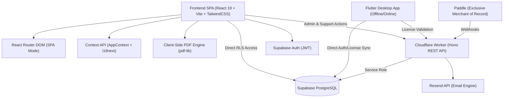
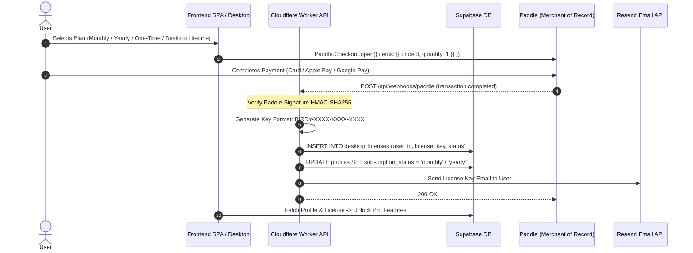

# 🏗 System Architecture & Tech Stack (`architecture.md`)

[⬅ Back to Master Index](file:///Users/evgenymendus/Documents/WebDev/kdp%20book%20assembler/docs/master_index.md) | [Next: KDP Math Engine ➡](file:///Users/evgenymendus/Documents/WebDev/kdp%20book%20assembler/docs/kdp_math.md)

---

## 1.1 Technology Stack



* **Frontend Framework:** React 19 / Vite (ESM bundler), TailwindCSS for styling tokens.
* **Localization:** `i18next` + `react-i18next` with JSON resource dictionaries (`ru.json`, `en.json`).
* **PDF Compilation:** `pdf-lib` executing purely client-side in Web Workers / Main Thread.
* **Serverless Backend:** Cloudflare Workers running `Hono` framework (`kdp-backend.emitera.workers.dev`).
* **Database & Auth:** Supabase (PostgreSQL 15+) with Row-Level Security (RLS) and JWT authentication.
* **Payment Gateway (Merchant of Record):** **Paddle** (exclusive gateway; Allpay has been completely purged).
* **Email Engine:** Resend API integration for transactional emails, license key delivery, and support ticket dispatch.
* **Edge Hosting:** Cloudflare Pages (SPA hosting with rewrite rules `/* -> /index.html`).

---

## 1.2 Supabase Database Schema & RLS

### Table: `public.profiles`
Stores user subscription state, generation balances, and role privileges.
```sql
CREATE TABLE public.profiles (
    id UUID PRIMARY KEY REFERENCES auth.users(id) ON DELETE CASCADE,
    email TEXT NOT NULL,
    role TEXT NOT NULL DEFAULT 'user' CHECK (role IN ('user', 'admin')),
    subscription_status TEXT NOT NULL DEFAULT 'free' CHECK (subscription_status IN ('free', 'onetime', 'monthly', 'yearly', 'canceled', 'lifetime')),
    subscription_id TEXT,
    subscription_expires_at TIMESTAMPTZ,
    generation_credits INTEGER NOT NULL DEFAULT 0,
    has_lifetime_access BOOLEAN NOT NULL DEFAULT false,
    is_lifetime_free BOOLEAN NOT NULL DEFAULT false,
    created_at TIMESTAMPTZ NOT NULL DEFAULT NOW(),
    updated_at TIMESTAMPTZ NOT NULL DEFAULT NOW()
);
```

### Table: `public.payment_settings` / `public.app_settings`
Dynamic gateway orchestration and price controls (Paddle Exclusive).
```sql
CREATE TABLE public.payment_settings (
    id TEXT PRIMARY KEY DEFAULT 'global',
    active_gateway TEXT NOT NULL DEFAULT 'paddle' CHECK (active_gateway IN ('paddle')),
    paddle_environment TEXT NOT NULL DEFAULT 'sandbox' CHECK (paddle_environment IN ('sandbox', 'production')),
    paddle_client_token TEXT DEFAULT '',
    paddle_api_key TEXT DEFAULT '',
    paddle_price_onetime TEXT DEFAULT '',
    paddle_price_monthly TEXT DEFAULT '',
    paddle_price_yearly TEXT DEFAULT '',
    updated_at TIMESTAMPTZ NOT NULL DEFAULT NOW()
);
```

### Table: `public.desktop_licenses` (Desktop Licensing System)
Tracks license keys, hardware device bindings, and expiration dates for the native desktop application. Keys are generated automatically upon successful payment via Paddle webhooks or manually via the Admin Panel.
```sql
CREATE TABLE public.desktop_licenses (
    id UUID PRIMARY KEY DEFAULT gen_random_uuid(),
    user_id UUID REFERENCES auth.users(id) ON DELETE CASCADE,
    license_key TEXT UNIQUE NOT NULL,
    hardware_id TEXT,
    status TEXT NOT NULL DEFAULT 'active' CHECK (status IN ('active', 'revoked', 'expired')),
    expires_at TIMESTAMPTZ,
    created_at TIMESTAMPTZ NOT NULL DEFAULT NOW(),
    updated_at TIMESTAMPTZ NOT NULL DEFAULT NOW()
);

-- Indexes for instant key and user lookup
CREATE INDEX idx_desktop_licenses_key ON public.desktop_licenses(license_key);
CREATE INDEX idx_desktop_licenses_user ON public.desktop_licenses(user_id);
CREATE INDEX idx_desktop_licenses_hw ON public.desktop_licenses(hardware_id);
```

### Table: `public.support_tickets`
Ticket inbox for user feedback and error reports.
```sql
CREATE TABLE public.support_tickets (
    id UUID PRIMARY KEY DEFAULT gen_random_uuid(),
    user_id UUID REFERENCES auth.users(id) ON DELETE SET NULL,
    email TEXT NOT NULL,
    category TEXT NOT NULL,
    subject TEXT,
    message TEXT NOT NULL,
    status TEXT NOT NULL DEFAULT 'open' CHECK (status IN ('open', 'in_progress', 'resolved', 'closed')),
    created_at TIMESTAMPTZ NOT NULL DEFAULT NOW(),
    updated_at TIMESTAMPTZ NOT NULL DEFAULT NOW()
);
```

### Table: `public.healthcheck` (Supabase Anti-Pause System)
Dedicated table for scheduled REST Keep-Alive heartbeats to prevent database auto-pause.
```sql
CREATE TABLE IF NOT EXISTS public.healthcheck (
    id TEXT PRIMARY KEY DEFAULT 'birdy_ping',
    last_ping TIMESTAMPTZ DEFAULT TIMEZONE('utc'::text, NOW()) NOT NULL
);
```

### Row Level Security (RLS) Policies
1. **`profiles`**:
   * `SELECT`: Authenticated users can read their own profile (`auth.uid() = id`), or `admin` can read all.
   * `UPDATE`: Non-billing fields only; credit and subscription updates are restricted to `service_role` or `admin`.
2. **`desktop_licenses`**:
   * `SELECT`: Authenticated users can view only their own licenses (`auth.uid() = user_id`) or `admin`.
   * `INSERT/UPDATE/DELETE`: Restricted to `admin` role and backend `service_role`.
3. **`payment_settings`**:
   * `SELECT`: Public read (for client pricing rendering).
   * `UPDATE/INSERT`: Restricted to `admin` role or `service_role`.
4. **`support_tickets`**:
   * `INSERT`: Public / Authenticated (`anon`, `authenticated`).
   * `SELECT/UPDATE`: Restricted to `admin` role or ticket owner (`auth.uid() = user_id`).
5. **`healthcheck`**:
   * `SELECT/INSERT/UPDATE`: Permitted for `anon` and `service_role` to enable automated GitHub Action & client keepalive pings.

---

## 1.3 Auth, Payment Routing & MoR Pipeline



---

## 1.4 Admin CRM & License Control Hub
In the web Admin Panel ([AdminPanel.jsx](file:///Users/evgenymendus/Documents/WebDev/kdp%20book%20assembler/frontend/src/components/AdminPanel.jsx)):
* **Create User Modal (`POST /api/admin/create-user`):** Create new user accounts directly through Supabase Auth Admin API with pre-allocated credits, roles, and plan statuses.
* **Role & Lifetime Management:** Switch user roles (`user`/`admin`) and toggle `is_lifetime_free`.
* **Refund Policy Compensation:** Add/subtract generation credits (`+1`, `+5`, `-1`) with instant DB persistence.
* **Manual License Generation:** Click **«🔑 Выдать ключ» (Generate Free License)** to invoke `POST /api/admin/generate-license`, creating a `BIRDY-XXXX-XXXX-XXXX` key in `desktop_licenses` and notifying the user.
* **Instant Revocation:** Click **«🚫 Отозвать» (Revoke)** to invoke `POST /api/admin/revoke-license`, setting `status = 'revoked'` to immediately block desktop access.

---

## 1.5 Security Architecture, AppSec & Defense-in-Depth

The backend and frontend implement strict defense-in-depth principles:

### 1. Admin Authorization Middleware
All administrative routes under `/api/admin/*` are shielded by a mandatory middleware in [backend/src/index.ts](file:///Users/evgenymendus/Documents/WebDev/kdp%20book%20assembler/backend/src/index.ts):
```ts
app.use('/api/admin/*', async (c, next) => {
  const authHeader = c.req.header('Authorization');
  const result = await verifyAdminUser(c.env, authHeader);
  if (!result.authorized) {
    return c.json({ error: result.error }, result.status as any);
  }
  await next();
});
```
`verifyAdminUser` validates the Supabase session token and verifies that `profiles.role === 'admin'`. Unauthenticated or unauthorized callers receive immediate `401 Unauthorized` or `403 Forbidden` responses.

### 2. Paddle Billing Webhook HMAC-SHA256 Verification
`POST /api/webhooks/paddle` enforces cryptographic integrity:
* Reads the raw body and parses the `Paddle-Signature` header (`ts=...;h1=...`).
* Reconstructs the signed payload `${ts}:${rawBody}`.
* Computes the HMAC-SHA256 digest using `PADDLE_WEBHOOK_SECRET` via native Web Crypto API (`crypto.subtle`).
* Compares hashes using constant-time string comparison (`timingSafeEqual`) to prevent side-channel timing attacks.
* Enforces a 5-minute replay attack window against forged past events.

### 3. Edge Rate Limiting (Sliding Window)
In-memory sliding-window rate limiters running on Cloudflare Workers edge nodes prevent brute-force and resource exhaustion:
* **`POST /api/desktop/validate-license`**: 30 requests per minute per client IP.
* **`POST /api/support/ticket`**: 5 requests per 10 minutes per client IP.

### 4. Credential Masking & Data Leakage Prevention
* `GET /api/admin/payment-settings` masks `paddle_api_key` (`padd_••••••••xxxx`) before returning data to client browsers.
* `POST /api/admin/update-payment-settings` detects masked strings and prevents accidental overwrite of active credentials.

---

## 1.6 Supabase Anti-Idle Infrastructure (Keep-Alive)

To protect the Supabase PostgreSQL database from entering auto-pause after periods of inactivity on free/starter tiers, Birdy Pages operates a dual-layer Keep-Alive mechanism:

1. **Autonomous GitHub Action (`.github/workflows/supabase-keepalive.yml`):**
   * Scheduled cron: `0 5 */2 * *` (every 2 days at 05:00 UTC) with `workflow_dispatch` trigger.
   * Executes [scripts/supabase-keepalive.ts](file:///Users/evgenymendus/Documents/WebDev/kdp%20book%20assembler/scripts/supabase-keepalive.ts) using native `fetch`.
   * Upserts the heartbeat record in `public.healthcheck` (`id: 'birdy_ping'`).
   * Fallback: If `healthcheck` table is unreachable, queries `desktop_licenses` (limit 1) to guarantee REST activity.
2. **Client-Side Opportunistic Heartbeat:**
   * Upon web application initialization in [frontend/src/App.jsx](file:///Users/evgenymendus/Documents/WebDev/kdp%20book%20assembler/frontend/src/App.jsx), `pingSupabaseKeepAlive()` triggers an asynchronous non-blocking touch to `public.healthcheck`.

---

## 1.7 Frontend Code-Splitting & Performance Engine

To maximize Core Web Vitals (FCP, LCP, INP), secondary application modules are dynamically imported using `React.lazy` and `Suspense`:
* [AdminPanel.jsx](file:///Users/evgenymendus/Documents/WebDev/kdp%20book%20assembler/frontend/src/components/AdminPanel.jsx) (CRM, billing config, licenses).
* [SupportPage.jsx](file:///Users/evgenymendus/Documents/WebDev/kdp%20book%20assembler/frontend/src/components/SupportPage.jsx) (ticket submission).
* [DocViewer.jsx](file:///Users/evgenymendus/Documents/WebDev/kdp%20book%20assembler/frontend/src/components/DocViewer.jsx) (Terms, Refund Policy, Privacy Policy).

This architecture isolates heavy components, preventing 180+ kB of non-critical JavaScript from blocking the primary book assembling dashboard.

