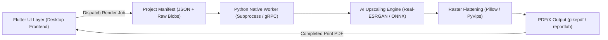
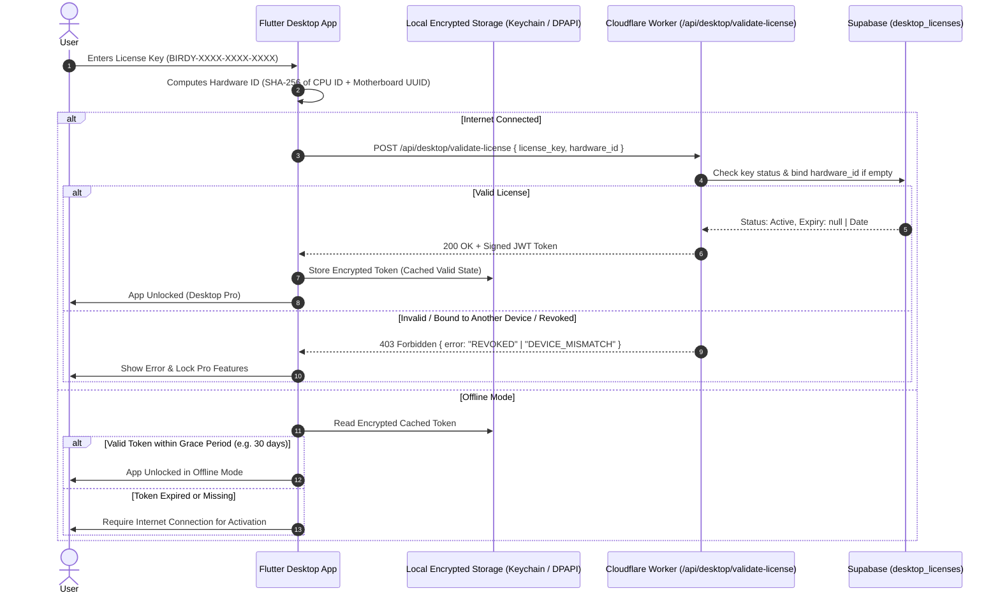

# 🚀 Desktop Bridge: Upscaling, Flattening & Licensing (`desktop_bridge.md`)

[⬅ Back to Rendering Engine](file:///Users/evgenymendus/Documents/WebDev/kdp%20book%20assembler/docs/rendering_engine.md) | [Master Index](file:///Users/evgenymendus/Documents/WebDev/kdp%20book%20assembler/docs/master_index.md)

---

## 4.1 Architecture Bridge (Flutter UI ⟷ Python Engine)



---

## 4.2 Data Hooks & State Serialization Pipeline
The desktop bridge intercepts document state at the export trigger. The JSON schema passed to the Python worker is defined as:

```json
{
  "project_id": "book_98432",
  "kdp_spec": {
    "binding_type": "hardcover",
    "trim_width_in": 8.5,
    "trim_height_in": 11.0,
    "page_count": 120,
    "paper_type": "white",
    "bleed": true,
    "spine_width_in": 0.2702,
    "full_cover_width_in": 18.5772,
    "full_cover_height_in": 12.4320
  },
  "cover": {
    "type": "full_wrap",
    "asset_path": "/tmp/assets/cover_raw.png",
    "spine_text": {
      "content": "MY AWESOME BOOK",
      "font_family": "Inter",
      "font_size_pt": 12,
      "color_hex": "#000000",
      "direction": "top_to_bottom"
    }
  },
  "pages": [
    { "page_number": 1, "asset_path": "/tmp/assets/page_001.png" },
    { "page_number": 2, "asset_path": "/tmp/assets/page_002.png" }
  ]
}
```

---

## 4.3 Flattening Engine & Alpha Channel Stripping (RIP Safety)
KDP print RIP (Raster Image Processor) engines frequently fail or produce white box artifacts when handling semi-transparent PNGs, PDF transparency groups, or overlapping vector layers.

### Python Flattening Standard:
```python
import pyvips
from PIL import Image

def flatten_kdp_layer(foreground_path: str, target_width_px: int, target_height_px: int) -> Image.Image:
    """
    Renders the image onto a solid 100% white background,
    stripping alpha channels completely to produce a pristine 24-bit RGB bitmap.
    """
    img = Image.open(foreground_path).convert("RGBA")
    
    # 1. Create a pure white background
    background = Image.new("RGB", (target_width_px, target_height_px), (255, 255, 255))
    
    # 2. Resize foreground preserving aspect ratio
    img.thumbnail((target_width_px, target_height_px), Image.Resampling.LANCZOS)
    
    # 3. Center foreground on canvas
    offset_x = (target_width_px - img.width) // 2
    offset_y = (target_height_px - img.height) // 2
    
    # 4. Composite using alpha mask
    background.paste(img, (offset_x, offset_y), mask=img.split()[3])
    
    return background  # Mode 'RGB' with no alpha channel
```

---

## 4.4 Local AI Upscaling Pipeline
For low-resolution user assets ($< 300\text{ DPI}$), the Python engine invokes a local ONNX Runtime / Real-ESRGAN pass:

1. **Target Metric:** $\text{Target Pixel Dimensions} = \text{Dimension (inches)} \times 300\text{ DPI}$.
2. **Threshold Verification:** If $\text{Original DPI} < 300$, the asset routes through the upscaler model before flattening.
3. **Color Space Assurance:** Convert output to standard sRGB IEC61966-2.1 or US Web Coated (SWOP) v2 profile.

---

## 4.5 Offline/Online License Verification System



### Key Components:
1. **Hardware ID Binding:** Generated deterministically on the client using SHA-256 hash of system identifiers (`MachineGUID` on Windows, `IOPlatformUUID` on macOS, `/etc/machine-id` on Linux).
2. **Offline Resilience:** Once verified online, Flutter securely stores an encrypted JWT signature. The app permits fully offline operations (local AI upscaling, zero-crop PDF compilation) and re-verifies periodically in the background when connectivity is restored.
3. **Instant Remote Revocation:** If a key is revoked in the Admin Panel or through a Paddle refund, the next server ping locks the application.
